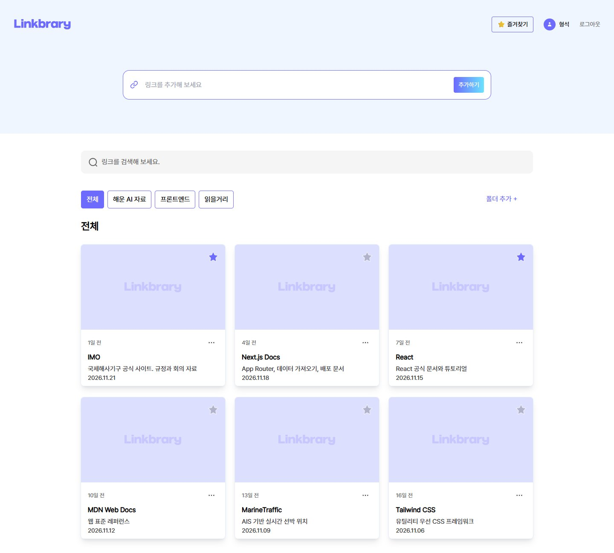
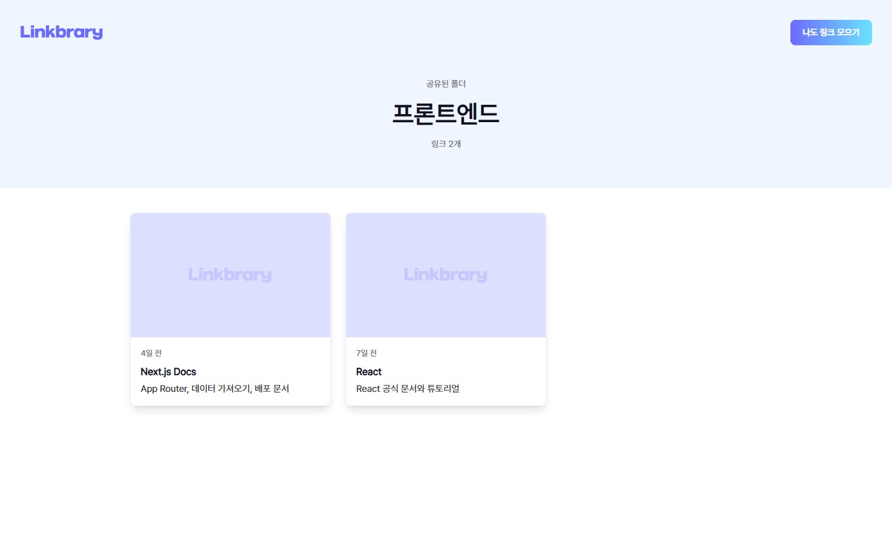

# Linkbrary — 팀 프로젝트 이후 개인 마무리판

코드잇 FE 11기 4팀 프로젝트([원본 저장소](https://github.com/codeit-fe11-part3-team4/linkbrary))를 포크해,
팀 기간에 끝내지 못한 부분을 2026년 11월에 혼자 마무리한 저장소입니다. 팀 기간에는 메인 랜딩 페이지와
반응형 레이아웃, 로그인 상태에 따른 버튼 표시, 링크 추가 버튼을 맡았습니다(아래 원본 README 참고).

| 링크 목록 | 공유된 폴더 (로그인 없이 보기) |
| --- | --- |
|  |  |

화면 캡처의 폴더와 링크는 화면을 보여 주기 위한 예시 데이터입니다.

### 마무리한 것

- **폴더 공유** — 공유 버튼이 지금 보고 있는 주소(`/links`)를 복사하던 것을 폴더 공유 주소(`/share?folder=ID`)로 바꾸고,
  비어 있던 공유 페이지를 만들었습니다. 폴더 조회·폴더 링크 조회 API는 로그인 없이 열려 있어, 받은 사람이 바로 볼 수 있습니다.
- **로그인** — 로그인 실패가 성공처럼 넘어가던 문제(오류를 삼키던 `login`)를 고치고, 로그인이 필요한 화면은
  로그인 화면으로 보냈다가 끝나면 원래 화면으로 돌아오게 했습니다. 동작하지 않던 소셜 로그인 아이콘은 뺐습니다.
- **레이아웃** — 대시보드 레이아웃이 `<html>`·`<body>`를 한 번 더 그리던 중첩을 없앴습니다.
- **카드** — 링크 제목을 보여 주고, 'minutes ago'와 30일 넘으면 무조건 'a month ago'로 나오던 시간을
  '3분 전', '2개월 전', '1년 전'처럼 한국어로 바꿨습니다. 폴더별 링크 수로 페이지 수를 계산하던 버그도 고쳤습니다.
- **정리** — 개발용 `/test` 페이지 삭제, 비어 있던 자주 묻는 질문·개인정보 안내 페이지 작성.

---

# 🔗 Codeit FE 11기 4팀 프로젝트 Linkbrary


## 〰️ 프로젝트 설명
- [배포 사이트](https://fe11-team4-linkbrary.netlify.app/)   
- 원하는 링크를 저장, 검색, 공유 그리고 폴더로 관리할 수 있는 서비스

## ➰ 팀원 
|||||
|:-:|:-:|:-:|:-:|
|[@Gwanhoo](https://github.com/Gwanhoo)|[@Jiwoo11111](https://github.com/Jiwoo11111)|[@seoki0804](https://github.com/seoki0804)|[@Sookyeong02](https://github.com/Sookyeong02)|
| 김관호| 석지우| 안형석| 장수경 |


## ➖ 프로젝트 기간
- 2024년 12월 13일(금) ~ 2025년 1월 2일(목)

## 🛠 기술  스택
### IDE & 개발 도구
  
  
  
  
  


### 프론트엔드 기술
  
  
  
  
  

### 협업 및 문서화
  
  


---

<details>
<summary><b>⚙️ 개발 작업</b></summary>

---

## **1. 브랜치 규칙**
- **`main` 브랜치**: 최종 작업물만 머지하는 브랜치입니다.
- **`develop` 브랜치**: 모든 작업은 PR(Pull Request)을 통해 `develop` 브랜치에 머지합니다.
- **새로운 작업 시**:
  - 새로운 파일/폴더를 생성할 때는 [노션](https://www.notion.so/part-3-4-159802dbf0358052992ac8cfa431cdf8)에서 정리된 **파일 및 이름 규칙**을 준수해주세요.


## **2. 작업 순서**
1. **이슈 추가**
   - 본인의 작업 내용을 **Issues**에 추가합니다:  
     → **Issues** → **New Issue** → **Get Started**
   - 이슈 제목: 작업 내용을 간략히 작성합니다.
   - 이슈 본문: 양식에 따라 작성해주세요.

2. **브랜치 생성**
   - 이슈 번호를 기반으로 브랜치를 생성합니다.  
   - 브랜치 이름 규칙:  
     ```
     feature-본인이름/#이슈번호
     ```
   - 반드시 `develop` 브랜치에서 새로운 브랜치를 생성해주세요.
  

## **3. PR 규칙**
- **PR은 `develop` 브랜치를 대상으로 생성**해주세요.
- PR 제목은 작업 내용을 간략히 요약하거나 이슈 번호를 포함해주세요.
- PR은 **2명 이상의 승인**을 받아야 `develop` 브랜치에 머지할 수 있습니다.
- 다른 작업물(PR)이 `develop` 브랜치에 머지되었을 경우, **`develop` 브랜치를 pull하여 최신 상태를 유지**해주세요:
  ```bash
  git pull origin develop

## **4. PR 리뷰**
* **팀원들의 PR을 수시로 리뷰해주세요.**  
* 리뷰 시 개선 사항 또는 확인이 필요한 점은 코멘트로 남겨주세요.
  
## **5. 새로운 프레임워크 추가 시**
* 새로운 프레임워크 또는 라이브러리를 설치한 경우, PR 설명에 해당 내용을 반드시 기재해주세요.  
* **다른 팀원은 이를 반영하기 위해 **git pull**과 **npm install**을 반드시 실행해야 합니다:**
```python
git pull origin develop
```
```python
npm install
```
